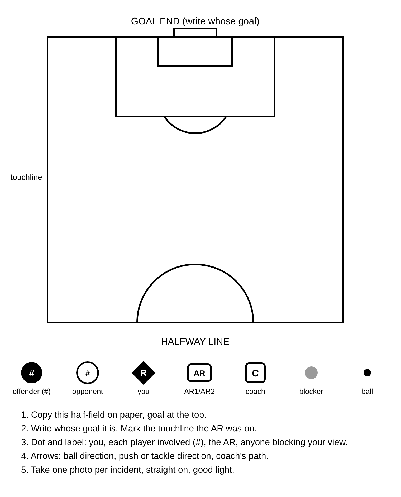
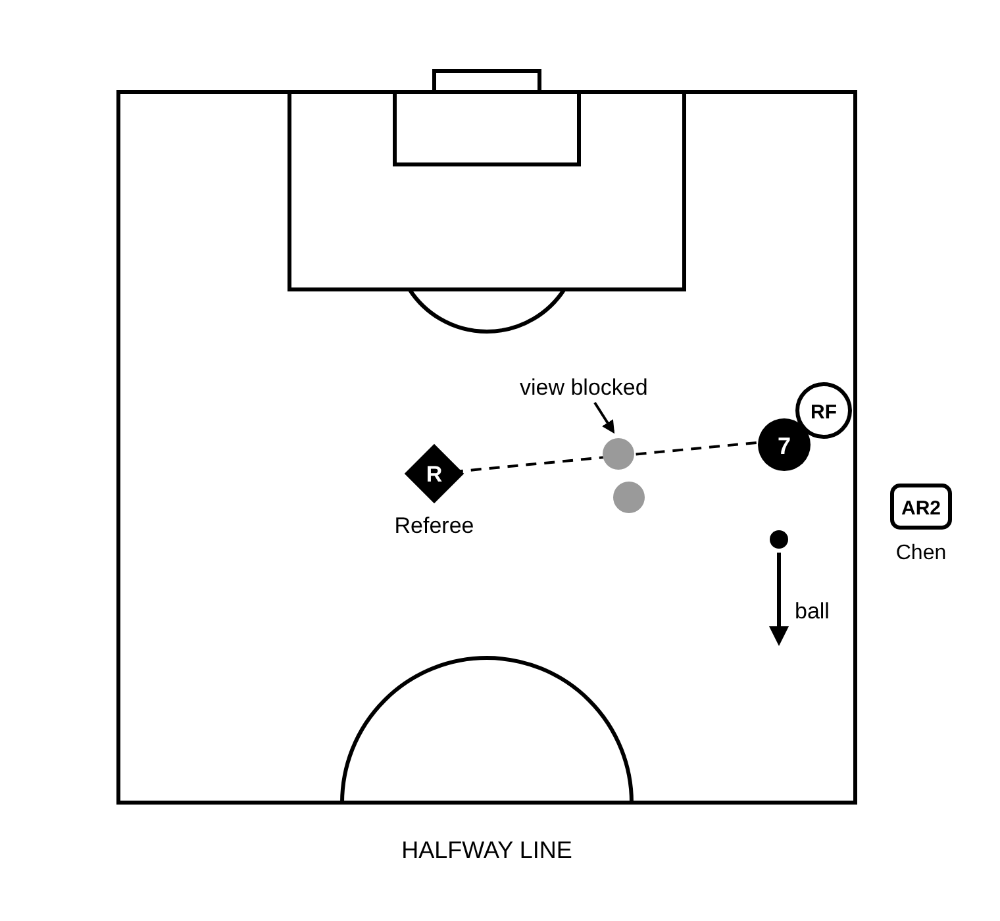

# ussf-report

An AI agent skill that helps soccer referees write supplemental reports: send-offs, team official misconduct, injuries, abandonments, and anything else unusual.

It doesn't just format what you type. It interviews you one incident at a time so nothing important gets left out, drafts the report in the neutral, factual tone disciplinary committees expect, and turns a phone photo of a quick paper sketch into a clean field diagram.

You get:

- A PDF and Word file per report, on a USSF Referee Program supplemental report template
- One plain-text version of every report from the match, for pasting into a league app or web form
- Field diagrams placed under the paragraphs they illustrate

It follows the open [Agent Skills](https://agentskills.io/specification) format, so the same folder works in Claude, ChatGPT, and GitHub Copilot.

## How it works

1. **Interview.** You describe what happened. The skill asks follow-up questions by incident type (fouls, DOGSO/SPA, dissent, team officials, injuries, rescinded decisions, abandonments) and plays back a fact summary for you to confirm.
2. **Draft.** First person, past tense, actions instead of labels, exact quotes, every observation attributed. No opinions, intent, or hypotheticals. You review it before any files are built.
3. **Diagrams.** It sends you the sketch guide below. You draw the incident on paper, take a photo, and it redraws it.
4. **Build and deliver.** PDF, Word, and plain text, with notes on where and when to submit.

| Sketch guide | Finished diagram |
|---|---|
|  |  |

## Install

### Claude (claude.ai and the desktop app)

Requires a Pro, Max, Team, or Enterprise plan with code execution turned on.

1. Download the skill as a zip with the folder at the top level:
   ```bash
   git clone https://github.com/amattas/ussf-report
   cd ussf-report
   git archive --prefix=ussf-report/ -o ../ussf-report.zip HEAD
   ```
   (Or use **Code > Download ZIP** on GitHub, unzip it, rename the folder to `ussf-report`, and zip that folder.)
2. In Claude, go to **Settings > Capabilities > Skills** (or **Customize > Skills**), choose **Upload skill**, and select `ussf-report.zip`.
3. Turn the skill on.
4. Start a chat with something like "I need to write a send-off report for a match today."

### Claude Code

```bash
git clone https://github.com/amattas/ussf-report ~/.claude/skills/ussf-report
```

Start `claude` and describe the incident, or type `/ussf-report`. To update later: `git -C ~/.claude/skills/ussf-report pull`.

### ChatGPT

Skill uploads are available on Business, Enterprise, and Edu workspaces where the admin has enabled skill uploading.

1. Build the zip the same way as for Claude (step 1 above).
2. In the ChatGPT sidebar, open **Plugins**, then the **Skills** tab.
3. Choose **Create > Upload from your computer** and select the zip.
4. Start a new chat and describe the incident. Mention the skill by name if it doesn't pick it up.

On other plans, create a Custom GPT: paste `SKILL.md` into its instructions, upload the `references/`, `assets/`, `scripts/`, and `examples/` files as knowledge, and turn on Code Interpreter. The interview and drafting work anywhere. Diagrams and PDF output depend on what the code environment has installed (see Requirements).

### GitHub Copilot (CLI, Visual Studio, VS Code agent mode)

Install as a personal skill:

```bash
git clone https://github.com/amattas/ussf-report ~/.copilot/skills/ussf-report
```

Or with the GitHub CLI:

```bash
gh skill install amattas/ussf-report SKILL.md --agent github-copilot --scope user
```

In Copilot CLI, run `/skills reload`, then `/skills info ussf-report` to confirm it loaded. In Visual Studio and VS Code, use Copilot in agent mode.

## Requirements for the scripts

The interview and drafting need nothing installed. Building files does:

- Python 3
- For diagrams: Playwright with Chromium (`pip install playwright && playwright install chromium`), or `pip install cairosvg`
- For PDF output: LibreOffice (`soffice` on the PATH). Without it you still get the Word file and the plain text.

## Run the scripts yourself

```bash
python3 scripts/draw.py guide sketch-guide.png
python3 scripts/draw.py spec examples/spec.example.json diag/
python3 scripts/build_report.py examples/spec.example.json assets/supplemental-template.docx diag/ out/
```

## Layout

| Path | What it is |
|---|---|
| `SKILL.md` | Skill instructions |
| `references/interview.md` | Question checklists by incident type |
| `references/writing-standards.md` | Tone rules, what to leave out, tone check, before/after example |
| `assets/supplemental-template.docx` | Report template: header, logo, page numbers, empty body |
| `assets/sketch-guide.png` | Sample diagram to copy on paper and photograph |
| `assets/example-diagram.png` | Example finished diagram |
| `scripts/draw.py` | Renders the sketch guide and incident diagrams |
| `scripts/build_report.py` | Fills the template, converts to PDF, writes the plain-text version |
| `examples/spec.example.json` | Complete spec with made-up teams and players |

## Diagram coordinates

Canvas is 760 by 700. Touchlines at x=90 and x=650, goal line and halfway line at y=70 and y=610. Penalty area is 300 wide by 150 deep, centred at x=370. Set `goal_at_top` to `false` to put the goal at the bottom.

Markers: `lex` (offender, solid circle), `opp` (opponent, outline circle), `ref`, `ar`, `coach`, `other` (grey dot for players blocking the view), `ball`, `arrow`, `sight` (dashed line of sight), `text`.

## Disclaimer

This is a writing aid, not official guidance from U.S. Soccer or any league. Check your league's and sanctioning body's current rules for report formats, deadlines, and where to submit. The U.S. Soccer name and logo in the template belong to U.S. Soccer.
